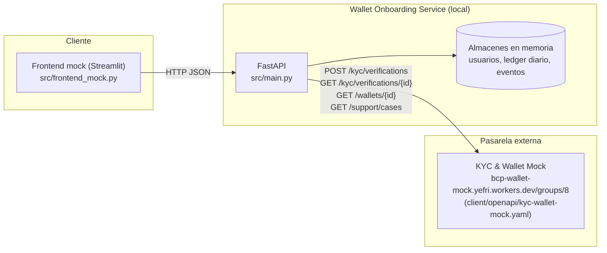

# digital-wallet-08 — Wallet Onboarding (MVP básico funcional)

> Hackathon de billetera digital — Grupo 8. Este README resume qué se construyó, cómo se construyó
> y qué evidencia respalda cada actividad realizada.

## 1. Resumen del proyecto

**Qué resuelve:** el onboarding de una billetera digital para personas naturales en Perú que hacen
compras, pagos y recargas de **montos pequeños**. El MVP cubre el recorrido de registro guiado, la
creación de una cuenta `ACTIVE_BASIC` contra un servicio real de verificación KYC simulada, y la
aplicación de los límites de operación de ese nivel.

**Para quién:** usuarios de smartphone que realizan transferencias diarias de bajo monto y que hoy
abandonan un onboarding lento (línea base: ~8 minutos) antes de poder pagar.

**Reto del hackathon:** el desafío completo de la billetera está organizado en semanas **W1–W6**
(registro/activación, pagos, QR, confirmación de estado, analítica, operaciones/compliance, según
`epic.md`). Nuestro equipo decidió **enfocar todo el tiempo disponible en consolidar W1 de extremo a
extremo** (especificación → arquitectura → implementación → pruebas reales), en vez de avanzar
superficialmente en varias semanas. Ver la tabla de cobertura en la sección 2.

**Valor de negocio (según `epic.md` y `mvp_detallefuncional.md`):**
- Reducir el tiempo de finalización de onboarding de 8 a 3 minutos.
- Permitir operar de inmediato (pagos y recargas propias hasta S/20 por operación y S/60 diarios)
  sin esperar una validación de identidad completa.
- Sostener el objetivo de negocio de 1,000–2,000 usuarios activos mensuales y un CAC de S/10 en los
  primeros 3 meses, mediante instrumentación básica del funnel de registro.

## 2. Cobertura del reto (W1–W6)

| Semana | Alcance (según material del reto) | Estado | Implementación | Evidencia |
|---|---|---|---|---|
| **W1 — Registro y activación** | `HU01 - Creacion de wallet.md`: registro guiado, creación de wallet vía mock KYC real, estados `ACTIVE_BASIC`, verificación de correo/celular/biometría simulada, límites por nivel | ✅ **Implementado (alcance "básico funcional" acordado)** | CA-01 a CA-05 completos y probados contra el mock real en vivo. CA-06 a CA-13 (OTP de correo/celular, biometría simulada, `ACTIVE_FULL`) quedaron **especificados en OpenSpec pero no implementados en código** (decisión de alcance documentada) | [architect.md](architect.md), [src/main.py](src/main.py), [src/frontend_mock.py](src/frontend_mock.py), [testing_report.md](testing_report.md), [chapter_review.md](chapter_review.md) |
| W2 — Pagos/transferencias de bajo monto (según `epic.md`) | No se recibió ni se exploró un mock/reto oficial de W2 en este repositorio | ⛔ **Fuera de alcance** | No implementado. Lo entregado en W1 incluye un *simulador local* de límites de pago/recarga (`/wallets/{id}/payments`, `/recharges`) sobre la misma wallet, **no** una integración con un mock de pagos real | — |
| W3 | Sin documentación del reto en este repositorio | ⛔ Fuera de alcance | No se evaluó | — |
| W4 | Sin documentación del reto en este repositorio | ⛔ Fuera de alcance | No se evaluó | — |
| W5 | Sin documentación del reto en este repositorio | ⛔ Fuera de alcance | No se evaluó | — |
| W6 | Sin documentación del reto en este repositorio | ⛔ Fuera de alcance | No se evaluó | — |

**Honestidad sobre el alcance interno de W1:** dentro de la propia HU01, los criterios CA-06 a CA-13
(verificación de correo y celular por OTP, biometría simulada, nivel `ACTIVE_FULL`) están
**especificados** en `openspec/changes/onboarding-wallet-registration/specs/profile-verification/spec.md`
pero **no tienen código**. Esto fue una decisión de alcance explícita (ver sección 7), no un olvido.

## 3. Arquitectura y decisiones

### Componentes



El diagrama de secuencia completo (camino feliz + `MANUAL_REVIEW` + `REJECTED` + `UNAVAILABLE`) y el
contrato OpenAPI local completo están en [architect.md](architect.md).

### Flujo resumido

1. El usuario completa el formulario guiado (nombres, apellidos, usuario, contraseña) en el
   frontend Streamlit, con validación en vivo.
2. El backend genera un documento sintético (`TEST-<uuid>`) — **nunca se pide un DNI real** — y
   llama a `POST /kyc/verifications` del mock externo real.
3. Según la respuesta del mock (`ACTIVE` / `PENDING` / `REJECTED` / `503`), el backend mapea el
   resultado a un nivel de aplicación (`ACTIVE_BASIC` o ninguno) y a un mensaje para el usuario.
4. Si la wallet queda `ACTIVE`, el frontend muestra la landing de bienvenida, el saldo y un panel
   para simular recargas/pagos respetando los límites de `ACTIVE_BASIC` (S/20 por operación, S/60
   diarios combinados).

### Decisiones clave y alternativas consideradas

| Decisión | Alternativa considerada | Por qué se eligió esta opción |
|---|---|---|
| Streamlit para el frontend | React/Angular con cliente HTTP propio | Permite iterar el flujo guiado y validar interacción real en minutos, prioridad del hackathon (velocidad de salida); se documenta como `frontend_mock` intencionalmente |
| Persistencia 100% en memoria (sin base de datos) | Activar el rol `data` (`agents/data.py`) y modelar tablas reales | El alcance "básico funcional" no requería sobrevivir reinicios para la demo; se documenta como deuda técnica explícita (sección 7) |
| Ledger de límites simulado localmente | Esperar/[pedir] un endpoint real de pagos del mock | El mock de W1 (`mock_flujo_registro.md`) **no expone** endpoints de pago/recarga; se optó por una simulación local transparente en vez de bloquear la demo de CA-05 |
| `testScenario` como gancho de prueba con bloqueo por `APP_ENV` | No exponer el campo en absoluto | Permite demostrar los 4 escenarios del mock (`APPROVED`/`MANUAL_REVIEW`/`REJECTED`/`UNAVAILABLE`) en vivo durante la evaluación, sin riesgo en producción (ver hallazgo corregido en `chapter_review.md`) |
| Karate (API) + Selenium (UI) | Solo pruebas manuales | Exigencia del flujo SDD de `agents/testing.py`; ambas suites se ejecutaron realmente contra el mock en vivo, no solo se diseñaron |

### Versiones utilizadas (verificadas en esta sesión)

| Componente | Versión |
|---|---|
| Python | 3.13.15 |
| FastAPI | 0.162.0 |
| Uvicorn | 0.54.0 |
| httpx | 0.28.1 |
| Pydantic | 2.14.2 |
| Streamlit | 1.66.1 |
| Selenium | 4.52.0 |
| pytest | 9.2.0 |
| Karate (standalone) | 2.1.4 |
| Java | 21.0.12.1 (Temurin LTS) |
| Maven | 3.10.0 |

## 4. Uso de IA

Esta solución se construyó con un agente de IA (GitHub Copilot CLI / asistente basado en LLM)
operando de forma interactiva y con ejecución real de comandos, no solo generación de texto.

- **Flujo de trabajo (SDD):** se usó **OpenSpec** para formalizar la historia de usuario en
  especificaciones verificables antes de escribir código (`openspec/changes/onboarding-wallet-registration/`),
  con `openspec validate --strict` como guardrail antes de avanzar a la implementación.
- **Prompts y roles:** el flujo solicitado — *architect → backend → frontend → testing → chapter* —
  usó las instrucciones ya definidas en [agents/](agents) (`architect.py`, `backend.py`,
  `frontend.py`, `testing.py`, `chapter.py`) como *brief* de cada rol. **Aclaración honesta:** estos
  archivos están escritos para orquestarse con CrewAI (`crew.llm_config`, un `main.py` propio), pero
  ese runtime **no está presente en este repositorio**. El agente de IA ejecutó cada rol
  directamente (sin CrewAI), produciendo exactamente los artefactos que cada módulo especifica
  (`SPEC_FILE` de cada agente: `architect.md`, `src/main.py`, `src/frontend_mock.py`,
  `testing_report.md`, `chapter_review.md`).
- **Herramientas/skills usadas:** CLI de OpenSpec, shell (PowerShell) para instalar dependencias y
  ejecutar backend/frontend/pruebas, navegador integrado para validar la UI real (capturas en
  `tests/selenium/screenshots/`), búsqueda web puntual (para ubicar el JAR oficial de Karate), y el
  formulario de preguntas al usuario (`ask_user`) para decisiones de alcance que **no debían
  asumirse** (ver sección 7).
- **MCP:** no se utilizó ningún servidor MCP en esta sesión; todas las integraciones externas
  (mock de KYC/Wallet) se consumieron vía HTTP directo desde el backend, no a través de un MCP.
- **Agentes delegados:** no se delegó trabajo a subagentes en background; todo el ciclo
  architect→backend→frontend→testing→chapter se ejecutó en una sola sesión continua para mantener
  consistencia de contratos entre capas (mismos nombres de campos y rutas en todos los artefactos).
- **Guardrails aplicados:**
  - Validación estricta de OpenSpec antes de tocar código.
  - Decisiones de alcance ambiguas (qué cubrir como "básico funcional", cómo documentar W2–W6)
    se confirmaron con el usuario vía `ask_user` en vez de asumirse.
  - Ninguna prueba se reporta como ejecutada sin evidencia real: `testing_report.md` y
    `chapter_review.md` marcan explícitamente **NO EJECUTADO** lo que no se corrió.
  - Durante la revisión final ("Chapter"), el propio proceso **encontró y corrigió** un hallazgo de
    seguridad real: el gancho de prueba `testScenario` no tenía restricción de entorno; se agregó el
    bloqueo por `APP_ENV=production` y se verificó en caliente (ver sección 6 y `chapter_review.md`).
  - La contraseña del usuario nunca se persiste, registra en logs ni se expone en respuestas
    (verificado leyendo el código, no solo asumido).

## 5. Cómo ejecutar

### Requisitos

- Python 3.11+ (probado con 3.13.15)
- Java 17+ y Maven (solo para correr las pruebas Karate; probado con Java 21 / Maven 3.10)
- Microsoft Edge instalado (Selenium Manager resuelve el driver automáticamente; probado con Edge)
- Conexión a internet (el backend llama al mock real en `bcp-wallet-mock.yefri.workers.dev`)

### Configuración

```powershell
# 1. Clonar/ubicarse en la carpeta del proyecto
cd digital-wallet-08-agents

# 2. Crear entorno virtual e instalar dependencias
python -m venv .venv
.\.venv\Scripts\python.exe -m pip install -r requirements.txt

# 3. (Opcional) copiar variables de entorno de ejemplo
copy .env.example .env
```

Ver [.env.example](.env.example) para el detalle de cada variable (ninguna es un secreto; el mock
externo no requiere credenciales).

### Ejecutar el backend

```powershell
.\.venv\Scripts\python.exe -m uvicorn src.main:app --host 127.0.0.1 --port 8000
```
- API: http://127.0.0.1:8000
- Documentación interactiva autogenerada: http://127.0.0.1:8000/docs

### Ejecutar el frontend

```powershell
.\.venv\Scripts\python.exe -m streamlit run src\frontend_mock.py --server.port 8501
```
- UI: http://localhost:8501

### Datos de ejemplo para probar el formulario

| Campo | Valor de ejemplo | Regla |
|---|---|---|
| Nombres | `Juan Carlos` | Solo letras y espacios, máx. 30 |
| Apellido paterno | `Rivera` | Solo letras, máx. 20 |
| Apellido materno | `Gomez` | Solo letras, máx. 20 |
| Usuario | `jcrivera_qa` | Letras, números, `. _ -`, máx. 20 |
| Contraseña | `C0ntr4se#ia!` | Se recomienda mezclar mayúsculas, minúsculas, números y símbolos |

En el paso de confirmación, el panel **"Opciones de prueba (QA)"** permite forzar el escenario del
mock (`APPROVED`, `MANUAL_REVIEW`, `REJECTED`, `UNAVAILABLE`) para evaluar los 4 caminos sin esperar
una coincidencia real. Ese campo queda **bloqueado automáticamente si `APP_ENV=production`**.

## 6. Evidencia y pruebas

Todo lo listado aquí se **ejecutó realmente** en esta sesión contra el backend, el frontend y el
mock externo en vivo (no son resultados simulados). Detalle completo, comandos exactos y matriz de
trazabilidad por criterio de aceptación: [testing_report.md](testing_report.md).

### Happy path (camino feliz)
- Registro completo vía UI (Selenium + verificación manual en navegador) → wallet `ACTIVE_BASIC`,
  saldo `S/0.00`, landing de bienvenida con nombre real.
- Pruebas Karate: `scenarios: 6 | passed: 6 | passed`.
- Pruebas Selenium/pytest: `1 passed in 15.49s`.

### Casos borde verificados
| Caso | Resultado observado |
|---|---|
| Usuario ya registrado | `400 USERNAME_TAKEN` + sugerencias sin símbolos |
| Nombre con carácter no alfabético | `422` (validación Pydantic) |
| Escenario `MANUAL_REVIEW` | Wallet `PENDING` + caso de soporte abierto (`GET /support/cases`) |
| Escenario `REJECTED` | Wallet `REJECTED`; pago posterior → `409 WALLET_NOT_OPERATIONAL` |
| Escenario `UNAVAILABLE` (mock `503`) | `503` sin wallet creada |
| Pago que excede el límite por operación (S/20) | `403 PER_OPERATION_LIMIT_EXCEEDED` |
| Pagos/recargas que exceden el límite diario (S/60) | `403 DAILY_LIMIT_EXCEEDED` |
| `testScenario` con `APP_ENV=production` | `400 TEST_SCENARIO_NOT_ALLOWED` (hallazgo corregido en vivo) |

### Logs y guardrails verificados
- La contraseña nunca aparece en ningún log, evento analítico o respuesta HTTP (revisión de código).
- Los eventos de analítica (`POST /analytics/events`) no incluyen nombres, usuario ni contraseña.
- `openspec validate onboarding-wallet-registration --strict` → `is valid` antes de implementar.

## 7. Trade-offs y aprendizajes

### Qué no se hizo (explícito)
- Verificación de correo/celular por OTP y biometría simulada (CA-06 a CA-11 de HU01): quedaron
  especificadas en OpenSpec pero sin código, por decisión de alcance para priorizar profundidad
  sobre amplitud dentro de W1.
- Nivel `ACTIVE_FULL` y sus límites ampliados (CA-12/CA-13): no implementado, depende de lo anterior.
- W2 a W6 del reto completo: no se abordaron; no se contaba con los mocks/retos correspondientes.
- Rol `security` (`agents/security.py`) y rol `data` (`agents/data.py`): no se activaron en este
  flujo (el usuario pidió explícitamente architect→backend→frontend→testing→chapter).
- Pruebas automatizadas de límites de `ACTIVE_BASIC` en Karate (se verificaron manualmente, no como
  `.feature`); aserción automatizada del aviso de "perfil pendiente" en Selenium.

### Deuda técnica conocida
- **Persistencia en memoria:** todo el estado (usuarios, wallets, ledger diario, eventos) se pierde
  al reiniciar el backend. No apto para producción tal cual.
- **Ledger de límites no es transaccionalmente seguro:** los diccionarios en memoria no tienen
  bloqueo; bajo concurrencia real podrían darse condiciones de carrera en el conteo diario. No se
  diseñaron pruebas de concurrencia.
- **El ledger de pagos/recargas es una simulación local**, no conectada a un movimiento real de
  saldo en el mock (el mock no lo expone). Un jurado técnico debe saber que el saldo mostrado en
  `GET /wallets/{id}` es el saldo real del mock, pero los "pagos"/"recargas" simulados **no lo
  modifican**.

### Riesgos
- El campo `testScenario` requiere que todos los despliegues reales configuren `APP_ENV=production`
  explícitamente; si se omite, el gancho de prueba queda disponible.
- No se ejecutó ningún análisis de seguridad automatizado (SAST/dependencias); la revisión de
  seguridad fue manual y acotada al código escrito en esta sesión.

### Siguiente iteración (recomendado)
1. Implementar `profile-verification` (OTP mock de correo/celular + biometría simulada) para
   habilitar `ACTIVE_FULL`, ya especificado en OpenSpec.
2. Mover el estado a una base de datos real (activar el rol `data`) y re-probar los mismos
   escenarios de esta entrega contra persistencia real.
3. Añadir pruebas Karate de límites de `ACTIVE_BASIC` y la aserción pendiente en Selenium.
4. Evaluar W2 (pagos/transferencias) en cuanto se disponga del mock oficial correspondiente.

## 8. Equipo

**Grupo:** digital-wallet-08

| Integrante | Rol | Principal contribución |
|---|---|---|
| Fernando Gomez | Product Owner | Definición de HU01, criterios de aceptación y decisiones de alcance (básico funcional, priorización W1) |
| Oswaldo Echavarria | Arquitecto SW | Diagramas de arquitectura/secuencia, contrato OpenAPI local y mapeo del contrato del mock externo ([architect.md](architect.md)) |
| Manuel Martinez | Developer BE | Implementación de la API FastAPI, integración con el mock real y lógica de límites ([src/main.py](src/main.py)) |
| Carlos Puente | Developer FE | Cliente Streamlit del flujo de onboarding ([src/frontend_mock.py](src/frontend_mock.py)) |
| Jhon Ñahui | Tester | Suites Karate (API) y Selenium (UI), informe de pruebas con evidencia real ([testing_report.md](testing_report.md)) |
| Juan Mendienta | Chapter | Revisión final integral, matriz de trazabilidad y veredicto ([chapter_review.md](chapter_review.md)) |