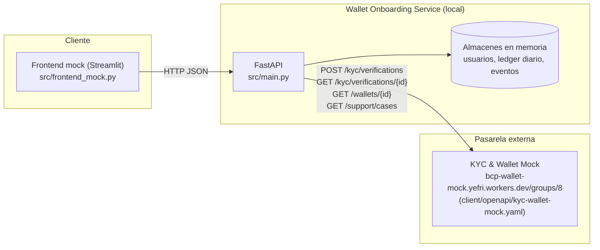
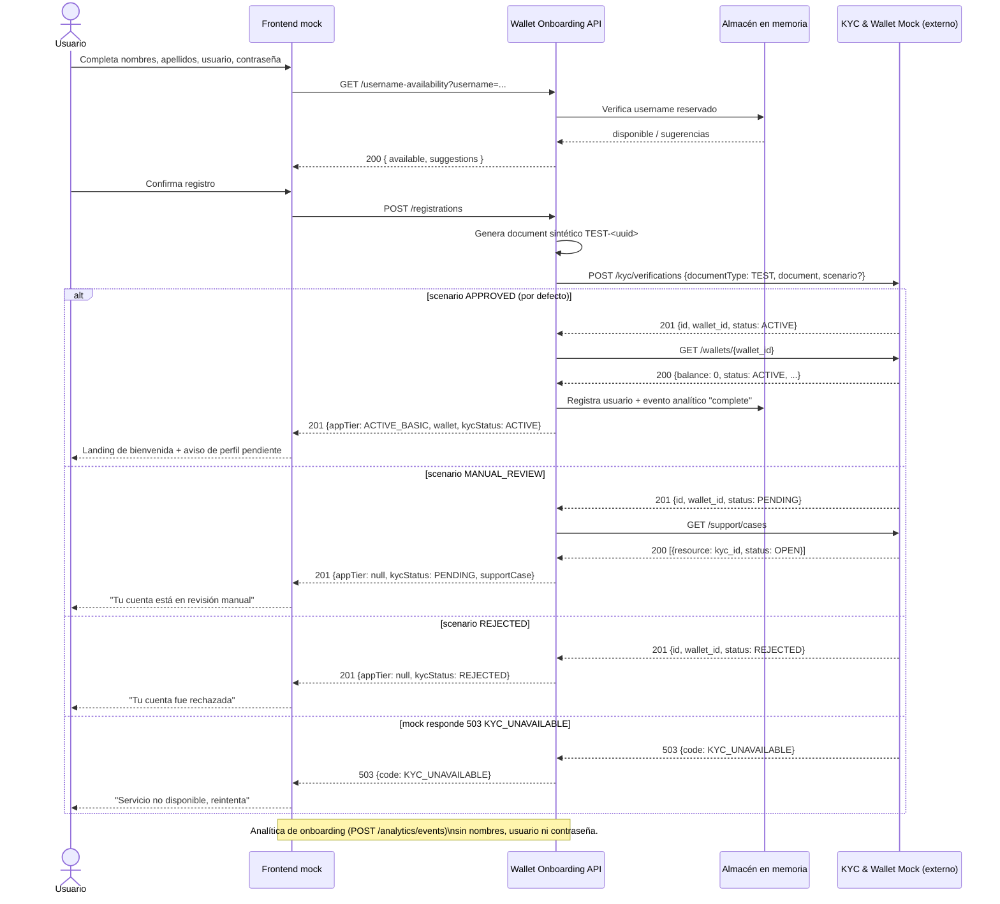

# Informe de Arquitectura — HU01 Creación de Wallet (MVP básico funcional)

> Rol: **Architect** (ver [agents/architect.py](agents/architect.py)).
> Alcance de esta iteración: **básico funcional** = registro guiado (CA-01/CA-02) + creación y
> consulta de wallet contra el mock real (CA-03/CA-04) + límites `ACTIVE_BASIC` (CA-05), según lo
> acordado al actualizar `openspec/changes/onboarding-wallet-registration`.
> Quedan fuera de esta iteración: verificación de correo/celular/biometría (`profile-verification`),
> nivel `ACTIVE_FULL` y la analítica agregada de MAU/CAC — documentados como trabajo futuro.

<<<ARQUITECTURA>>>


<<<SECUENCIA>>>


<<<OPENAPI>>>
```yaml
openapi: 3.0.3
info:
  title: Wallet Onboarding Service (MVP básico funcional)
  version: "0.1.0"
  description: >
    API local que orquesta el registro guiado de HU01 y lo integra con el mock
    externo documentado en client/openapi/kyc-wallet-mock.yaml. Persistencia en
    memoria (sin base de datos) para esta iteración de demo.
servers:
  - url: http://localhost:8000

paths:
  /username-availability:
    get:
      summary: Verifica disponibilidad de un nombre de usuario.
      parameters:
        - name: username
          in: query
          required: true
          schema: { type: string, maxLength: 20 }
      responses:
        '200':
          description: Resultado de disponibilidad.
          content:
            application/json:
              schema: { $ref: '#/components/schemas/UsernameAvailability' }
        '400':
          description: Usuario con formato inválido.
          content:
            application/json:
              schema: { $ref: '#/components/schemas/ErrorResponse' }

  /registrations:
    post:
      summary: Registra al usuario y crea su wallet contra el mock de KYC.
      requestBody:
        required: true
        content:
          application/json:
            schema: { $ref: '#/components/schemas/RegistrationRequest' }
      responses:
        '201':
          description: Registro procesado (ACTIVE_BASIC, PENDING o REJECTED).
          content:
            application/json:
              schema: { $ref: '#/components/schemas/RegistrationResult' }
        '400':
          description: Datos de registro inválidos o usuario no disponible.
          content:
            application/json:
              schema: { $ref: '#/components/schemas/ErrorResponse' }
        '503':
          description: El mock de KYC no está disponible (KYC_UNAVAILABLE).
          content:
            application/json:
              schema: { $ref: '#/components/schemas/ErrorResponse' }
        '502':
          description: Respuesta inesperada del mock de KYC.
          content:
            application/json:
              schema: { $ref: '#/components/schemas/ErrorResponse' }

  /wallets/{walletId}:
    get:
      summary: Consulta saldo, estado KYC y nivel de aplicación de una wallet.
      parameters:
        - name: walletId
          in: path
          required: true
          schema: { type: string }
      responses:
        '200':
          description: Vista consolidada de la wallet.
          content:
            application/json:
              schema: { $ref: '#/components/schemas/WalletView' }
        '404':
          description: Wallet no encontrada.
          content:
            application/json:
              schema: { $ref: '#/components/schemas/ErrorResponse' }

  /wallets/{walletId}/kyc:
    get:
      summary: Consulta el estado de verificación KYC y su caso de soporte, si existe.
      parameters:
        - name: walletId
          in: path
          required: true
          schema: { type: string }
      responses:
        '200':
          description: Estado de verificación.
          content:
            application/json:
              schema: { $ref: '#/components/schemas/KycStatusView' }
        '404':
          description: Wallet no registrada localmente.
          content:
            application/json:
              schema: { $ref: '#/components/schemas/ErrorResponse' }

  /wallets/{walletId}/recharges:
    post:
      summary: Simula una recarga propia respetando los límites de ACTIVE_BASIC.
      parameters:
        - name: walletId
          in: path
          required: true
          schema: { type: string }
      requestBody:
        required: true
        content:
          application/json:
            schema: { $ref: '#/components/schemas/AmountRequest' }
      responses:
        '201':
          description: Recarga simulada aceptada.
          content:
            application/json:
              schema: { $ref: '#/components/schemas/LedgerEntry' }
        '403':
          description: Límite por operación o diario excedido, o wallet no ACTIVE.
          content:
            application/json:
              schema: { $ref: '#/components/schemas/ErrorResponse' }
        '404':
          description: Wallet no registrada localmente.
          content:
            application/json:
              schema: { $ref: '#/components/schemas/ErrorResponse' }

  /wallets/{walletId}/payments:
    post:
      summary: Simula un pago respetando los límites de ACTIVE_BASIC.
      parameters:
        - name: walletId
          in: path
          required: true
          schema: { type: string }
      requestBody:
        required: true
        content:
          application/json:
            schema: { $ref: '#/components/schemas/AmountRequest' }
      responses:
        '201':
          description: Pago simulado aceptado.
          content:
            application/json:
              schema: { $ref: '#/components/schemas/LedgerEntry' }
        '403':
          description: Límite por operación o diario excedido.
          content:
            application/json:
              schema: { $ref: '#/components/schemas/ErrorResponse' }
        '404':
          description: Wallet no registrada localmente.
          content:
            application/json:
              schema: { $ref: '#/components/schemas/ErrorResponse' }
        '409':
          description: Wallet rechazada o pendiente; no admite pagos.
          content:
            application/json:
              schema: { $ref: '#/components/schemas/ErrorResponse' }

  /analytics/events:
    post:
      summary: Registra un evento del funnel de onboarding (sin PII ni contraseñas).
      requestBody:
        required: true
        content:
          application/json:
            schema: { $ref: '#/components/schemas/AnalyticsEvent' }
      responses:
        '202':
          description: Evento aceptado.

components:
  schemas:
    UsernameAvailability:
      type: object
      properties:
        username: { type: string }
        available: { type: boolean }
        suggestions:
          type: array
          items: { type: string }

    RegistrationRequest:
      type: object
      required: [nombres, apellidoPaterno, apellidoMaterno, username, password, flowId]
      properties:
        nombres: { type: string, maxLength: 30 }
        apellidoPaterno: { type: string, maxLength: 20 }
        apellidoMaterno: { type: string, maxLength: 20 }
        username: { type: string, maxLength: 20 }
        password: { type: string, writeOnly: true }
        flowId:
          type: string
          description: Identificador no personal para enlazar eventos analíticos del mismo flujo.
        testScenario:
          type: string
          enum: [APPROVED, REJECTED, MANUAL_REVIEW, UNAVAILABLE]
          description: Solo para pruebas; fuerza el escenario del mock. Omitir en producción.

    RegistrationResult:
      type: object
      properties:
        username: { type: string }
        kycId: { type: string }
        walletId: { type: string }
        kycStatus: { type: string, enum: [ACTIVE, PENDING, REJECTED] }
        appTier: { type: string, nullable: true, enum: [ACTIVE_BASIC] }
        balance: { type: integer }
        currency: { type: string }
        supportCase:
          type: object
          nullable: true
          properties:
            id: { type: string }
            status: { type: string }
        message: { type: string }

    WalletView:
      type: object
      properties:
        walletId: { type: string }
        kycStatus: { type: string, enum: [ACTIVE, PENDING, REJECTED] }
        appTier: { type: string, nullable: true, enum: [ACTIVE_BASIC] }
        balance: { type: integer }
        reserved: { type: integer }
        available: { type: integer }
        currency: { type: string }
        limits:
          type: object
          nullable: true
          properties:
            perOperation: { type: integer, example: 2000 }
            dailyRemaining: { type: integer }

    KycStatusView:
      type: object
      properties:
        kycId: { type: string }
        walletId: { type: string }
        status: { type: string, enum: [ACTIVE, PENDING, REJECTED] }
        supportCase:
          type: object
          nullable: true
          properties:
            id: { type: string }
            status: { type: string }

    AmountRequest:
      type: object
      required: [amount]
      properties:
        amount:
          type: integer
          description: Monto en céntimos de PEN.

    LedgerEntry:
      type: object
      properties:
        walletId: { type: string }
        type: { type: string, enum: [RECHARGE, PAYMENT] }
        amount: { type: integer }
        dailyTotal: { type: integer }
        dailyRemaining: { type: integer }
        timestamp: { type: string, format: date-time }

    AnalyticsEvent:
      type: object
      required: [flowId, type]
      properties:
        flowId: { type: string }
        type: { type: string, enum: [start, step, complete, abandon] }
        step: { type: string, nullable: true }
        timestamp: { type: string, format: date-time, nullable: true }

    ErrorResponse:
      type: object
      properties:
        code: { type: string }
        message: { type: string }
```

<<<INFORME>>>
## Resumen y alcance

Esta iteración implementa el recorrido **básico funcional** de HU01: formulario de registro con
validaciones (CA-02), creación de wallet contra el mock real de KYC (CA-03), manejo de los cuatro
escenarios documentados en `mock_flujo_registro.md` (CA-03/CA-04 extendidos) y aplicación de los
límites de `ACTIVE_BASIC` (CA-05) sobre un ledger diario simulado localmente, ya que el mock no
expone endpoints de pago/recarga reales.

Quedan fuera de esta entrega (ver `openspec/changes/onboarding-wallet-registration/design.md`):
verificación de correo/celular con OTP mock, biometría simulada y el nivel `ACTIVE_FULL`
(capacidad `profile-verification`), y la agregación de métricas de MAU/CAC
(capacidad `onboarding-analytics`). Se deja un endpoint mínimo de eventos para no perder la
medición de tiempo de onboarding (CA-01).

## Componentes y responsabilidades

- **Frontend mock (`src/frontend_mock.py`)**: cliente Streamlit que guía el registro paso a paso,
  valida en vivo y consume la API local.
- **Wallet Onboarding API (`src/main.py`)**: orquesta la validación de datos, genera el documento
  sintético `TEST-`, invoca el mock externo, mapea su respuesta al modelo de nivel de aplicación
  (`ACTIVE_BASIC`) y aplica los límites de operación.
- **Almacenes en memoria**: nombres de usuario reservados, estado de wallets conocidas (kyc_id,
  wallet_id, tier), ledger diario de pagos/recargas y cola de eventos analíticos. No hay base de
  datos en esta iteración (no se activó el rol `data` para este alcance).
- **Mock externo KYC & Wallet**: fuente de verdad de `status` (`ACTIVE`/`PENDING`/`REJECTED`) y de
  saldo; su contrato está documentado en `client/openapi/kyc-wallet-mock.yaml` y fue verificado en
  vivo (`POST /kyc/verifications`, `GET /wallets/{id}`, escenario `MANUAL_REVIEW` y
  `GET /support/cases`) antes de diseñar esta arquitectura.

## APIs externas de `client/openapi` utilizadas

| Operación | Endpoint | Uso |
|---|---|---|
| `createKycVerification` | `POST /kyc/verifications` | Alta de wallet en el registro |
| `getWallet` | `GET /wallets/{id}` | Saldo/estado tras el alta y en refresh |
| `listSupportCases` | `GET /support/cases` | Enlazar el caso abierto en `MANUAL_REVIEW` |
| `decideKycVerification` | *(no usado en esta iteración; reservado para `profile-verification`/biometría)* | — |
| `getKycVerification` | *(no usado en esta iteración)* | — |

## Trazabilidad de criterios de aceptación

| Criterio | Componente que lo resuelve |
|---|---|
| CA-01 (inicio y seguimiento) | `POST /analytics/events`, frontend (paso visible) |
| CA-02 (datos de registro) | Validaciones de `POST /registrations` y `GET /username-availability` en backend; feedback en vivo en frontend |
| CA-03 (creación de cuenta básica) | `POST /registrations` → `createKycVerification` + `getWallet` |
| CA-04 (aviso de perfil pendiente) | Frontend, landing tras `201 ACTIVE_BASIC` |
| CA-05 (operaciones `ACTIVE_BASIC`) | `POST /wallets/{id}/recharges` y `/payments` con ledger diario parametrizable |

## Supuestos y preguntas pendientes

- El mock no ofrece endpoints de pago/recarga reales; el ledger de límites es una simulación local
  que no modifica el saldo real del mock. Se documenta como limitación conocida.
- `testScenario` en `RegistrationRequest` es un gancho de prueba para ejercitar `MANUAL_REVIEW`,
  `REJECTED` y `UNAVAILABLE` desde el frontend/QA. Está bloqueado por `APP_ENV=production` en el
  backend (`src/main.py`): si `APP_ENV=production`, cualquier solicitud con `testScenario` recibe
  `400 TEST_SCENARIO_NOT_ALLOWED`. Verificado en esta sesión contra el backend en ejecución.
- Persistencia: todo el estado vive en memoria del proceso backend (se reinicia al reiniciar el
  servidor). Suficiente para la demo; no sustituye una base de datos real.
- Reintentos ante `503 KYC_UNAVAILABLE`: no se implementa backoff automático; el frontend ofrece un
  botón de reintento manual (ver riesgo ya registrado en `design.md`).

<<<FIN>>>
